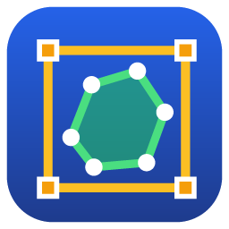

# YOLO Annotator

A small, standalone Windows image annotator written in Rust (egui). It labels
**bounding boxes, instance-segmentation polygons and polylines** and writes
**Ultralytics YOLO** label files.

It includes AI assist: click an object to get its polygon (SAM 2.1), or pre-label images with
your own YOLO model (see [AI assist](#ai-assist)).

## Install

**Requirements:** 64-bit Windows 10 or 11. Nothing else needs to be installed: the AI engine,
the AI models and the Visual C++ runtime are included. A GPU is optional (the AI tools also run
on the CPU, just slower).

The program is **portable**: one folder that you unzip and run. No installer, no administrator
rights, and nothing is written to the Windows registry or system folders.

1. Download `YOLO-Annotator-<version>-win64.zip` (~690 MB).
2. Right-click it → **Extract All...** and choose any folder (e.g. `C:\Tools`, Documents,
   or a USB stick).
3. Open the extracted `YOLO Annotator` folder and run `yolo-annotator.exe`.
   If Windows shows *"Windows protected your PC"*, click **More info → Run anyway**
   (the program is not code-signed).
4. Optional: right-click `yolo-annotator.exe` → **Show more options → Send to → Desktop
   (create shortcut)**, or **Pin to Start**.

Keep the files together: `yolo-annotator.exe` uses the `models` and `runtime` folders next to
it. The exe on its own still works for manual annotation, but without the AI tools.

**Update:** extract the new zip and delete the old folder (or extract over it). Your
annotations and settings are kept.
**Remove:** delete the `YOLO Annotator` folder. To also remove the settings, delete
`%APPDATA%\YOLO Annotator`. Your annotations are never removed (they live next to your images).
**Several PCs:** copy the extracted folder, e.g. from a network share with
`robocopy "\\server\share\YOLO Annotator" "C:\Tools\YOLO Annotator" /E`. Nothing else is needed.

### Optional: CUDA add-on for NVIDIA GPUs

The standard package already uses any GPU through DirectML. On a PC with an **NVIDIA** GPU the
CUDA engine is faster (about 1.5x for preparing an image) and runs the larger, more accurate
SAM 2.1 base-plus model by default:

1. Download `YOLO-Annotator-<version>-cuda-addon.zip` (~1.7 GB).
2. Extract it into the **same place** where you extracted the program (the folder that
   contains `YOLO Annotator`). The zip contains `YOLO Annotator\runtime\cuda`, so it lands
   next to `runtime\directml`.
3. Restart the app. **AI assist → Status** (right panel) should show `... · CUDA` once you use
   the Magic tool. It needs an NVIDIA driver from 2023 or newer (version 528+); with an older
   driver the app falls back to DirectML and the status line says why.

### Check that it works

* Open a folder of images, press **M** (Magic tool) and click an object: a dashed polygon appears.
  The **AI assist → Status** line shows the engine in use, e.g. `SAM 2.1 small · DirectML`.
* Command-line check, run in the program folder (writes `ai_selftest.txt` and
  `ai_selftest.png` to the current folder): `yolo-annotator.exe --ai-selftest photo.jpg`

| Problem | Fix |
|---|---|
| "Windows protected your PC" | **More info → Run anyway** (unsigned program) |
| Status says *AI files not found* | the `models` / `runtime` folders are not next to the exe: keep the extracted folder complete |
| Status says *CUDA not usable (...)* | update the NVIDIA driver, or ignore it: DirectML is used instead |
| AI is slow (`· CPU`) | no usable GPU (old driver, virtual machine, remote desktop). It still works; pick **Model: SAM 2.1 tiny** for speed |

Settings are stored per user in `%APPDATA%\YOLO Annotator`. Annotations are written into your
dataset folder (`labels\`, `annotations.json`), never into the program folder.

## Quick start

1. Run `yolo-annotator.exe`. Click **Open** (Ctrl+O) or drag a folder onto the window.
   All images in all sub-folders are found, and the left pane shows them as a folder tree
   with labeled/total counts per folder.
2. Classes are read from `data.yaml` (or `labels/classes.txt`) if present; otherwise add them
   in the right panel (type a name, press Enter).
3. Pick a tool in the **toolbox** at the top (icon buttons; the active tool is highlighted)
   or press its key. **Q** flips between the Selector and the annotation tool you used last.
   | Tool | How |
   |---|---|
   | **Box (B)** | drag a rectangle |
   | **Polygon (P)** | click points; click the first point, double-click, right-click or Enter to close |
   | **Polyline (L)** | click points; double-click, right-click or Enter to finish |
   | **Select / Edit (V)** | click a shape; drag its points or the whole shape; double-click an edge to add a point; right-click a point to remove it; Del deletes the shape |
   | **Magic (M)** | AI (SAM 2.1): click an object, or drag a box around it, to get its polygon; Enter or double-click accepts it |

   **Editing without switching tools:** a shape you just drew stays selected. Drag its
   handles (box corners or edge midpoints, polygon points) to resize, or the round centre grip
   to move it. In the Box tool, click a shape to select it; in Polygon/Polyline, right-click it.
   **Del** deletes the selected shape and **Esc** deselects. Only the *selected* shape is
   editable in the drawing tools, so you can still draw new boxes over or next to others.
4. Press **D** / **→** for the next image (A / ← for previous). The image's YOLO `.txt`
   is written as soon as you finish each edit (the status bar shows the file). No Save needed.
5. When done: **Export** (Ctrl+E) makes a train/val split ready for training.

The top bar, left to right: **Open · Save · Export** | the toolbox | **◀ ▶** previous/next image, **Fit**, **Undo**, **Auto** (auto-label) | format and polyline width | **ⓘ About**. Hover any button for its name and shortcut.

Mouse wheel zooms around the cursor. Middle-drag or Space+drag pans; in Select mode
you can also drag an empty area to pan. Keys 1–9 pick the class (and recolor the
selected shape). Ctrl+Z undoes, Ctrl+S saves, F fits the image to the window.

## AI assist

Two AI tools speed up labelling. Both create normal shapes that you then adjust by hand.

### Magic tool (M): click an object, get its polygon

Uses Meta's **SAM 2.1** (Segment Anything 2.1, Apache-2.0).

1. Choose the Magic tool (**M**). The image is prepared in the background (the banner at the
   top of the image says when it is ready; the next image is prepared while you work).
2. **Click the object.** Its outline appears as a dashed polygon.
   * Click more spots to **add** missed parts; **right-click** to **remove** wrong parts.
   * Or **drag a box** around the object.
   * **Backspace** removes the last point, **Esc** starts over.
3. **Enter** or **double-click** accepts it, with the current class. The polygon is selected:
   drag its points to fine-tune, or switch to the Selector (V).

In *Detection* format the Magic tool gives a box instead of a polygon.
The **Detail** slider (AI assist panel) sets how closely the polygon follows the edge
(smaller = more points).

### Auto-label with your own YOLO model

Once you have trained a first model on some labelled images, let it pre-label the rest:

1. Export it to ONNX: `yolo export model=runs/segment/train/weights/best.pt format=onnx`
   (detection models work too).
2. In the right panel, under **AI assist → Auto-label**, click **Browse...** and pick `best.onnx`.
3. **Auto** in the top bar (Ctrl+L) labels the current image, or **All unlabeled** runs the
   model on every unlabeled image in the background (images with no detections stay
   unlabeled). Then step through and fix the results.

Class names are taken from the model; names that are not in your class list yet are added.
YOLOv8 / YOLO11 and end-to-end (YOLO26 / YOLOv10) exports are supported, detection and
segmentation. Ctrl+Z undoes an auto-label on the current image.

### Hardware: picked automatically

| Engine | Used when | SAM 2.1 model (Auto) |
|---|---|---|
| **CUDA** | NVIDIA GPU, and the CUDA pack (`runtime\cuda`) is present | base-plus |
| **DirectML** | any DirectX 12 GPU (NVIDIA, AMD, Intel), built into Windows 10/11 | small |
| **CPU** | always works | tiny |

The status line in the AI assist panel shows what is running (e.g. `SAM 2.1 small · DirectML ·
160 ms/image`). Engine and model can be overridden there (an engine change applies after a
restart). If the GPU cannot be used, the app falls back to the CPU and says why.

Measured on a Core i5-13400 + RTX 4060 (810×1080 photo):

| | Prepare image | Each click |
|---|---|---|
| SAM 2.1 base-plus, CUDA | ~220 ms | ~35-45 ms |
| SAM 2.1 small, CUDA | ~110 ms | ~35 ms |
| SAM 2.1 small, DirectML | ~155 ms (1.5 s the first time) | ~35-45 ms |
| SAM 2.1 tiny, CPU | ~0.75-1.0 s | ~35-70 ms |
| YOLO11n-seg auto-label, CUDA | ~25 ms per image | |

**What to ship.**

| Folder | Size | Needed for |
|---|---|---|
| `yolo-annotator.exe` | ~10 MB | everything (manual annotation works with the exe alone) |
| `models\sam2.1-tiny`, `-small`, `-base-plus` | ~150 / 175 / 310 MB | the Magic tool; keep only the ones you want |
| `runtime\directml` | ~35 MB | AI on any PC (DirectX 12 GPU, or CPU) |
| `runtime\cuda` | ~2.1 GB | optional, NVIDIA only: ONNX Runtime GPU + cuDNN 9 + CUDA 12 runtime, no CUDA install needed |

Leave out `runtime\cuda` for PCs without an NVIDIA GPU (or to keep the download small: DirectML
also uses NVIDIA GPUs, a bit slower). Build without it: `.\build.ps1` (no `-Cuda`).

**Check the AI from the command line:**
`yolo-annotator.exe --ai-selftest photo.jpg [best.onnx] [auto|cuda|directml|cpu]` writes
timings to `ai_selftest.txt` and the results drawn on the image to `ai_selftest.png`.

## Large datasets

Tested with 5,000 images (1280×720, 2,500 with existing polygon labels):
- Opening the folder, including importing all existing labels, takes about a second.
- Next/previous image takes about 30 ms. The next image is decoded in the background while you annotate.
- The app uses about 90 MB of RAM and no CPU when idle.
- The folder tree draws only the rows on screen, so folders with tens of thousands of images stay smooth.
- Label `.txt` files are written instantly. The project file `annotations.json` is written when
  you move to another image, every 30 s, and on exit.

## Files written

Open the dataset root. Any layout works; an Ultralytics layout looks like this:

```
my_dataset/                <- the folder you open
  data.yaml                <- class names are read from here (if present)
  annotations.json         <- full-fidelity project file (all shapes, classes, settings)
  images/
    train/a.jpg
    val/night/b.jpg
  labels/                  <- created while you annotate
    train/a.txt
    val/night/b.txt
    classes.txt
```

Each label file goes where Ultralytics looks for it: the last `images` folder in the path is
replaced by `labels`. For a folder without an `images` component (e.g. `cats/x.jpg`), it goes
in a `labels` sub-folder (`cats/labels/x.txt`).

Existing YOLO `.txt` labels for the whole dataset are imported when the folder is opened.
Folders named `labels` and hidden folders are not scanned for images.

**Navigation pane:** click a folder to expand it, click an image to open it. The folder of
the current image opens automatically. Type in the filter box, or tick *Unlabeled only*, to get
a flat list of matching images. ✔ marks labeled images; `(bg)` marks background images (no objects).

### YOLO format (toolbar: "YOLO format")
* **Segmentation**: `class x1 y1 x2 y2 ...` (normalized). Boxes are written as 4-point
  polygons so the files stay valid for `yolo segment train`.
* **Detection**: `class cx cy w h`. Polygons and polylines are written as their bounding boxes.

**Polylines:** YOLO has no polyline type, so they are exported as a thin polygon band
(for example, for lane markings) of the width set in the toolbar ("Polyline width", in image
pixels). The band is previewed on screen. In `annotations.json` they stay real polylines.

### Export dataset
Creates
```
out/images/train, out/images/val[, out/images/test]
out/labels/train, out/labels/val[, out/labels/test]
out/data.yaml
```
With *Keep existing train / val / test folders* (default), images inside folders named
`train`, `val`/`valid` or `test` keep that split; others are split randomly by the validation
fraction. Sub-folders (e.g. `night/`) are kept.
The output folder must be outside the dataset and either empty or a previous export
(which is replaced, so no stale images remain). Export runs in the background with a progress bar.

Train with: `yolo segment train data=out/data.yaml model=yolo11n-seg.pt`
(or `yolo detect train ...` for detection format).

### Safety
* Label `.txt` files are written as soon as each edit is finished.
* If the app is closed unexpectedly, any label file newer than `annotations.json` is
  re-read on the next start, so recent edits are not lost.
* A damaged `annotations.json` is backed up as `annotations.corrupt.json` and labels are re-read
  from the `.txt` files. A locked or unreadable one stops the dataset from opening, so it is never overwritten.
* Images whose label files would clash (e.g. `a.jpg` and `a.png`) are reported when the folder is opened.

## Build from source

Requires Rust (MSVC toolchain) and the Visual Studio C++ Build Tools.

```powershell
./fetch_ai.ps1 -Cuda -CudaLibs   # once: SAM 2.1 models + ONNX Runtime DirectML + CUDA pack -> ai_assets\
./build.ps1 -Cuda      # -> dist\ (exe + models + runtimes); without -Cuda: no CUDA pack
cargo test             # unit tests (YOLO import/export, mask -> polygon)
./package.ps1          # -> release\ : portable zip + CUDA add-on zip
```

### Release packages (`release\`)

| File | Size | What it is |
|---|---|---|
| `YOLO-Annotator-<ver>-win64.zip` | ~690 MB | **Portable.** Unzip anywhere (even a USB stick) and run `yolo-annotator.exe`. Nothing is installed. |
| `YOLO-Annotator-<ver>-cuda-addon.zip` | ~1.7 GB | **Optional, NVIDIA only.** Unzip where the program was unzipped, for the CUDA engine. |

The program runs on any 64-bit Windows 10/11 PC with nothing else to install: the Visual C++
runtime needed by the AI engine ships in `runtime\vc`. Settings are stored per user in
`%APPDATA%\YOLO Annotator`; annotations are always written next to your images.

The program icon is drawn in code (`src/icon.rs`). After changing it, run
`cargo run --example gen_icon` to regenerate `assets/icon.ico` (embedded in the .exe by
`build.rs`) and `assets/icon.png`.

## License

MIT License. Copyright (c) 2026 DotoRobotics. See [LICENSE](LICENSE).

Third-party components shipped in `dist`: SAM 2.1 (Meta, Apache-2.0; ONNX export by
onnx-community), ONNX Runtime (Microsoft, MIT), DirectML (Microsoft, MIT), and in the CUDA pack
NVIDIA cuDNN / CUDA runtime libraries (NVIDIA license, redistributable).
